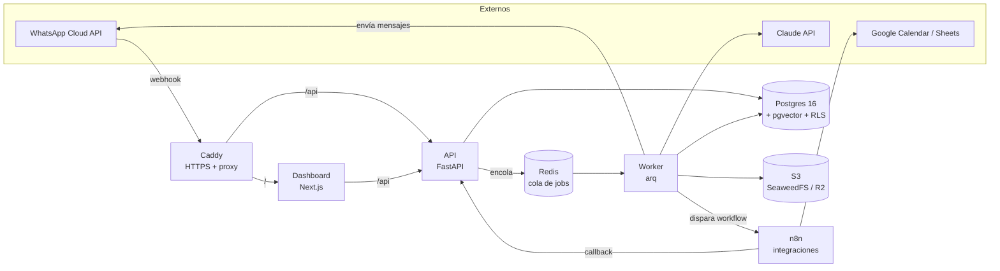
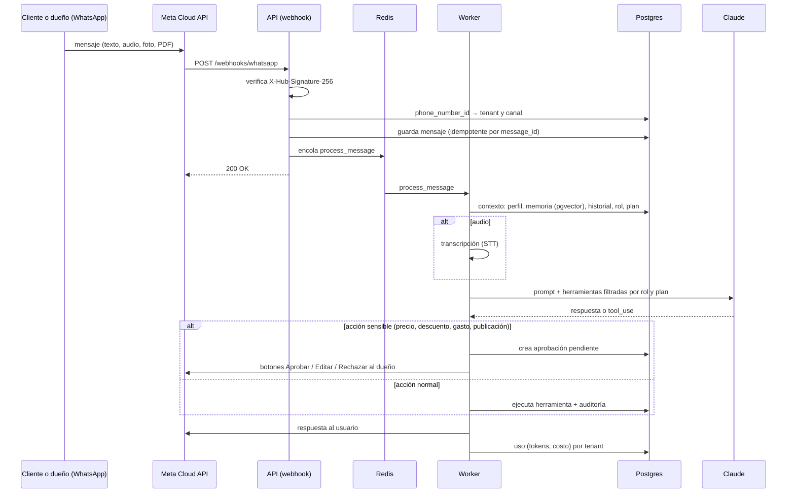

# Arquitectura

Universia Automatización WSP es un "empleado IA" que vive en WhatsApp. El dueño de una pyme
y su equipo le escriben como a un contacto más, y el asistente también atiende a los clientes
del negocio. Todo es multi-tenant: cada negocio es un tenant aislado.

## Componentes

## Flujo de un mensaje entrante (Fase 1)

El webhook responde 200 en menos de un segundo y todo lo lento pasa por la cola.

## Aislamiento entre tenants

- Toda tabla de negocio tiene `tenant_id` y una política de Row Level Security en Postgres.
- La app se conecta con el rol `universia_app`, que no es dueño de las tablas, así que RLS
  siempre aplica. Las migraciones corren con el usuario dueño.
- Cada transacción fija `app.tenant_id`, `app.user_id` y `app.operator` con
  `set_config(..., true)`; duran sólo esa transacción. Sin contexto, una consulta no ve nada.
- `app.operator = on` sólo lo fija el código del panel interno después de verificar que el
  usuario es operador.
- Los tests en `apps/api/tests/test_tenant_isolation.py` intentan leer y escribir datos de
  otro tenant y tienen que fallar.

## Modelo de datos (Fase 0)

| Grupo | Tablas |
| --- | --- |
| Cuentas | `tenants`, `users`, `memberships`, `roles`, `role_permissions` |
| Canales | `channels`, `message_templates` |
| Conversaciones | `contacts`, `conversations`, `messages` |
| Conocimiento | `documents`, `document_chunks` (vector de 1024 dimensiones) |
| Agente | `recipes`, `scheduled_jobs`, `approvals` |
| Planes y cobro | `plans`, `plan_features`, `subscriptions`, `usage_events` |
| Control | `audit_events`, `auth_tokens`, `user_sessions` |

Tablas globales, sin RLS: `tenants`, `users`, `roles`, `role_permissions`, `plans`,
`plan_features`, `auth_tokens`, `user_sessions`.

## Planes y entitlements

Los planes y sus límites viven en `plans` y `plan_features` (se cargan en la migración 0002).
El servicio `app/domains/entitlements` responde si un tenant puede usar una feature y cuánto
le queda en el período, contando `usage_events` desde el lunes 00:00 en la zona horaria del
tenant. Una suscripción morosa sigue funcionando hasta `grace_until`.

| Plan | USD/mes | Features |
| --- | --- | --- |
| base | 50 | whatsapp.atencion, asistente.personal, integraciones |
| pro | 100 | base + contenido.redes, redes.respuestas, ads.gestion, web.sitio, video.edicion (5 por semana, 120 s máx.) |
| ilimitado | 200 | pro sin cupo semanal de video (uso razonable: 40 por semana, configurable) |

## Permisos

Catálogo en `app/domains/permissions/catalog.py`, copiado a `role_permissions` por la
migración. Cada membresía puede sumar (`extra_permissions`) o quitar (`denied_permissions`)
permisos. Un empleado, por defecto, no ve finanzas ni auditoría.
